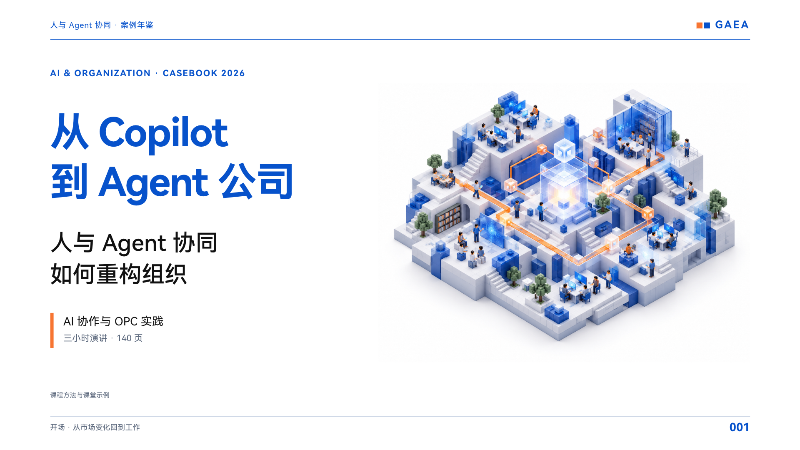
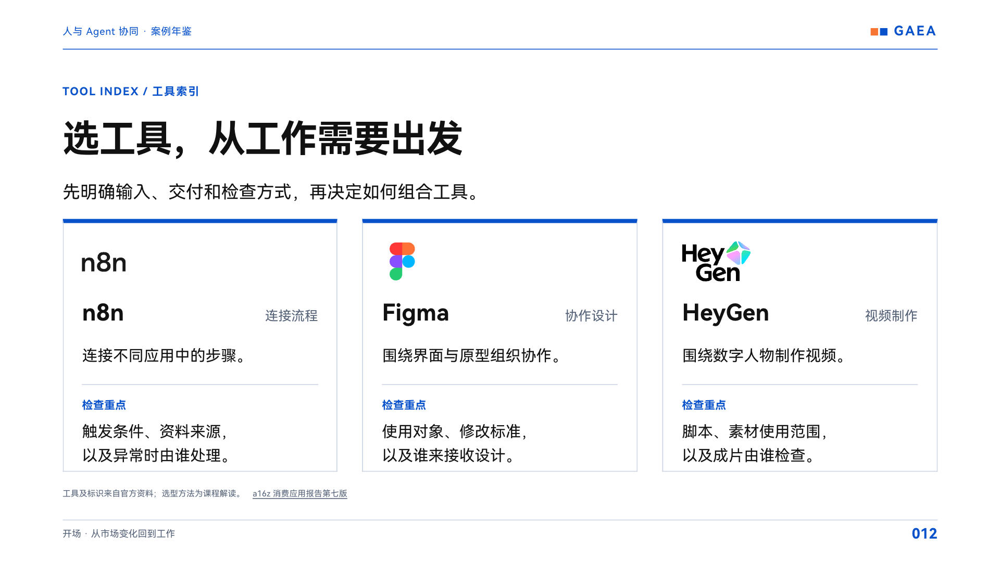
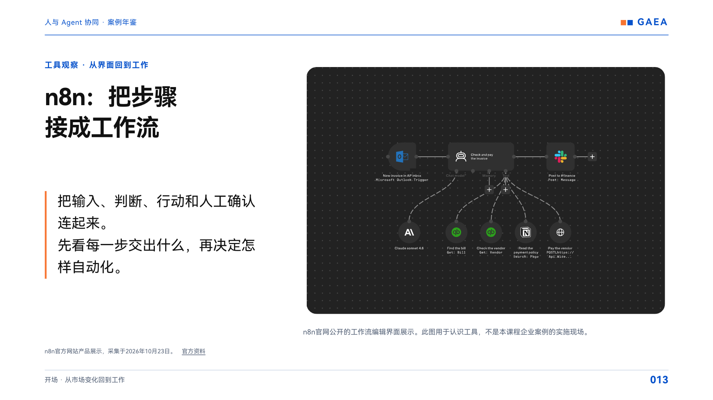

# Neo_PPT_skill

面向真实演讲的 **16:9 案例年鉴式 PPT 制作技能**：先理清材料和讲述主线，再形成逐页讲稿与页面，最后实际打开检查。

## 效果预览

下面4张图取自既有140页演讲成品的实际页面，展示封面、a16z人物、工具图标和工作流。**点击图片可查看1920×1080原图。**

| 版式示例 | 版式示例 |
|---|---|
| [](docs/previews/01-cover.png)<br>**立体像素封面** · 原第001页 | [](docs/previews/02-person-profile.png)<br>**人物首页** · 原第006页 |
| [](docs/previews/03-tool-icons.png)<br>**工具图标卡片** · 原第012页 | [](docs/previews/04-workflow.png)<br>**图文工作流** · 原第013页 |

页面保留原有日期和页码，用于展示已完成的排版效果，不作为最新行业报告或人物背书。[查看页面对应关系与素材来源](docs/previews/README.md)。

这是面向 **Codex、DeepSeek 等 AI Agent** 的 PPT 制作 Skill，包含工作方法、视觉规则和交付检查表。支持读取技能说明的 AI Agent 都可以按本规范工作；具体制作和验证由所用 Agent 结合当前材料与可用工具完成。它不是独立的 PPT 自动生成软件，也不附带一键生成程序。

## 适合做什么

- 将多份文稿、报告、表格和已有 PPT 整理成一场连贯的演讲。
- 制作蓝、白、橙配色的横版 HTML 演示稿，配合真实照片、项目界面和原始图表。
- 用“编辑导读 → 人物或团队 → 工作过程 → 成果与启示”讲清案例。
- 为页面编写对应讲稿，并安排章节导航、缩略图总览、演讲者窗口和图片放大等演示功能。
- 保持已确认的风格，按页修改、补充或删除内容，并检查是否误改其他部分。

默认以 HTML 演示稿为主要交付格式。需要 PDF、PowerPoint、页面图片或其他文件时，在任务中明确说明；技能会按本次范围安排，而不是把所有格式都强加给每个任务。

## 核心约定

| 方面 | 默认做法 |
|---|---|
| 工作顺序 | 材料 → 大纲 → 讲稿 → 样稿 → 完整演示 |
| 画面 | 16:9 横版、蓝色为主、橙色点缀、白底黑字 |
| 字体与排版 | 鸿蒙黑体作为起点；按投影可读性调整字号，段首不缩进、段间留白 |
| 新风格 | 先做10张代表性样稿；已有认可风格或要求一次完成时直接推进 |
| 案例 | 蓝底导读、人物或团队首页、白底图文正文；不固定每个案例的页数 |
| 配图 | 优先真实、清晰且与论点相关的图片，注明其身份与来源 |
| 现场节奏 | 默认不在观众页面标固定授课分钟数或休息倒计时 |
| 讲稿 | 解释和转场放入逐页讲稿，不把全文挤上页面 |
| 修改 | 先保留可恢复版本，只改用户指定范围 |
| 完成 | 实际检查画面、演示操作、离线打开及本次交付的导出文件 |

用户当前要求、已有成品和已确认样图始终优先。项目示例中的学校、主题、140页、案例编号和具体删改记录都不是新项目的固定要求。

## 安装与使用

仓库根目录的 [SKILL.md](SKILL.md) 是技能入口，名称为 **Neo_PPT_skill**。在 Codex 中可使用 **`$neo-ppt-skill`** 调用；其他 Agent 按其支持的方式加载技能说明及相关参考文件。

### Codex：使用 Git 安装（macOS / Linux）

需要已经安装 Git 和可加载本地技能的 Codex。以下命令将仓库放入个人技能目录；如果同名目录已存在，会停止安装，不覆盖现有技能。

```bash
neo_ppt_root="${CODEX_HOME:-$HOME/.codex}/skills"
neo_ppt_target="$neo_ppt_root/neo-ppt-skill"

if [ -e "$neo_ppt_target" ] || [ -L "$neo_ppt_target" ]; then
  printf '%s\n' "目标已存在，请先检查已有技能：$neo_ppt_target"
else
  mkdir -p "$neo_ppt_root"
  git clone https://github.com/tiamotogether/Neo_PPT_skill.git "$neo_ppt_target"
fi
```

已有同名技能时，先检查和备份本地修改，再决定如何更新；不要直接删除旧目录。

### Codex：下载文件安装

在 GitHub 点击 **Code → Download ZIP**，解压后将包含 `SKILL.md`、`agents/` 和 `references/` 的仓库文件夹重命名为 `neo-ppt-skill`，放入个人 Codex 的 `skills` 目录。不要与现有同名技能直接合并或覆盖。

安装后，在 Codex 中确认技能可见，再调用它。若当前会话未发现新技能，可重新打开 Codex 会话后检查。

### DeepSeek 等其他 AI Agent

支持技能安装的 Agent，可按其说明导入本仓库；支持上传文件或读取工作目录的 Agent，可提供 `SKILL.md` 和其中引用的 `references/` 文件，再用自然语言要求按本技能制作。安装位置和调用方式以所用 Agent 为准，`$neo-ppt-skill` 不是所有平台通用的命令。

技能规范不绑定特定模型或服务。生成文件、搜集图片和打开页面检查等工作，需要所用 Agent 具备相应工具；目前未逐一验证所有平台。

## 使用方法

在 Codex 中调用：

```text
使用 $neo-ppt-skill，根据我提供的材料制作一份60分钟的培训演讲。
先整理大纲和讲稿，再给我10张有代表性的样稿。
```

在 Codex、DeepSeek 等 AI Agent 中，加载技能说明后也可以使用自然语言：

```text
使用 Neo_PPT_skill，沿用已确认的蓝橙样式，完成24页HTML演讲稿。
只讲案例02和07，不在页面显示固定授课分钟数。
```

限定修改示例：

```text
使用 Neo_PPT_skill，把现有课件中所有带指定参考PPT名称的来源说明整行删除。
正文、图片、页码、其他来源和逐页讲稿都不改，只更新本次指定的交付文件。
```

提供主题、听众、时长、材料位置、已有版本和想要的交付格式，能帮助技能更准确地安排工作。缺少关键事实时会先处理可以继续的部分，不编造项目结果或人物资料。

## 文件说明

```text
Neo_PPT_skill/
├── README.md
├── LICENSE
├── .gitignore
├── SKILL.md
├── agents/
│   └── openai.yaml
├── docs/
│   └── previews/
│       ├── README.md
│       ├── 01-cover.png
│       ├── 02-person-profile.png
│       ├── 03-tool-icons.png
│       └── 04-workflow.png
└── references/
    ├── visual-spec.md
    ├── delivery-checklist.md
    └── project-example.md
```

- [技能入口](SKILL.md)：适用范围、制作方法、真实配图和限定修改原则。
- [视觉规范](references/visual-spec.md)：画布、色彩、字号与常用页面布局。
- [交付检查表](references/delivery-checklist.md)：内容、画面、交互、离线与导出核对。
- [项目示例](references/project-example.md)：一次长篇演讲如何形成这些约定。
- [Codex 显示与调用设置](agents/openai.yaml)：Codex 中的技能名称、简短说明和默认提示；其他 Agent 可直接读取技能入口。
- [效果图与来源](docs/previews/README.md)：4张实际页面截图、对应页码和素材出处。

## 素材与检查

本仓库包含技能规范、说明文档和4张成品页面效果图，不提供完整原始演讲 PPT、学员资料或字体文件。截图中的第三方人物照片、图标和其他素材保留各自权利，不受本项目 MIT 许可证覆盖；来源见[效果图说明](docs/previews/README.md)。制作新演讲时，需要另行提供或取得合适的素材，不能把本仓库开源视为取得第三方素材的额外使用授权。

技能要求检查真实交付物：包括逐页画面、前后翻页、章节和页码跳转、讲稿、演讲者窗口同步、图片放大及离线打开。若本次交付包含 PDF 或压缩包，还要确认它们与最终演示稿一致。检查方法写入规范，不代表未经制作的每一份新课件都已经通过验证。

## 贡献

欢迎通过 Issue 或 Pull Request 提交清楚的改进建议。请说明具体使用场景、遇到的问题和希望改变的行为；提交案例时不要附带个人资料、未获授权的客户材料或账户凭据。

## 许可证

本项目的技能规范与说明文档采用 [MIT License](LICENSE)。
